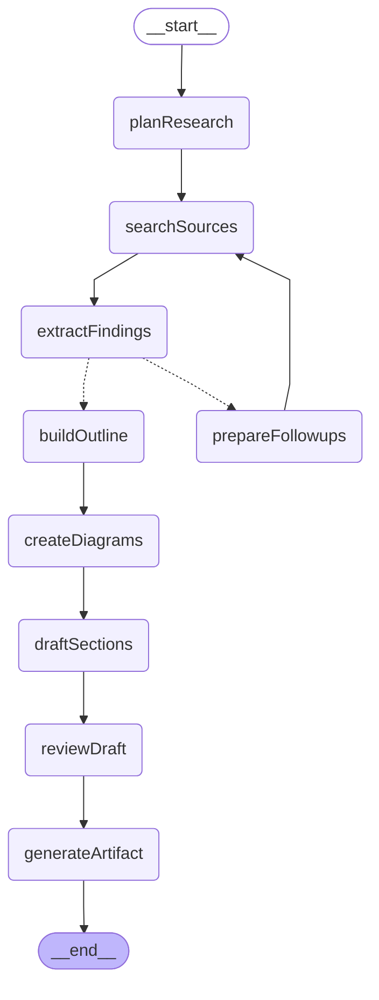

# Deep Research Graph

A subgraph that researches a topic over several rounds, then writes an evidence-backed document with figures
in the selected genre (paper, blog, LinkedIn).

## Graph structure

## Nodes

- **planResearch**: research brief (audience, thesis, language) with a genre-sized set of sub-questions and queries.
- **searchSources**: Tavily `advanced` search with full page markdown; dedupes by URL into a source registry `S1..Sn`.
- **extractFindings**: per sub-question, in parallel: findings (claim, numbers, quote, source ids, strength), gaps and follow-up queries. Findings citing sources the analyst did not read are dropped.
- **prepareFollowups**: another round while gaps remain and the genre allows it (`should_continue_research`).
- **buildOutline**: genre-shaped sections with goals, key points, findings, word budgets and figure requests.
- **createDiagrams**: AWS architectures through the aws-drawio-diagram skill's scripts (brief, auto layout, validation, drawio PNG export); concept figures through aws-diagram-design's `awsdiag.Canvas` and headless Chrome. Figures that fail validation are skipped.
- **draftSections**: parallel section drafts; may cite only `[S#]` of the assigned findings.
- **reviewDraft**: per-section edit notes on depth, argument, evidence, redundancy and genre fit.
- **generateArtifact**: sequential final pass streamed into the canvas; assembles numbered citation links, figures and references.

## Genre profiles (`genres.py`)

| Genre | Sub-questions | Max rounds | Max sources | Length | Figures | Citations |
|---|---|---|---|---|---|---|
| paper | 6-8 | 3 | 60 | 5,000-8,000 words | up to 3 | numbered + references |
| blog | 4-6 | 2 | 40 | 2,200-3,800 words | up to 2 | numbered + references |
| linkedin | 2-3 | 1 | 16 | short post | up to 1 | 1-3 inline links |

LinkedIn follows `~/.claude/skills/linkedin-writer/references/style-guide.md` (or `LINKEDIN_STYLE_GUIDE_PATH`) when present.

## Requirements

- `TAVILY_API_KEY` (missing key stops with an explicit error)
- Figures: `drawio` CLI (+ `xvfb-run`), Google Chrome, the aws-drawio-diagram and aws-diagram-design Claude Code plugins. Without them the document is written without figures.
- Figures are written to `data/research_assets/<runId>/` and served at `GET /api/research/assets/<runId>/<file>.png`.

## Where it is used

Called from the `deepResearch` node of the `open_canvas` graph; `generatePath` routes there when the request carries `researchGenre` (the composer's deep research button).
