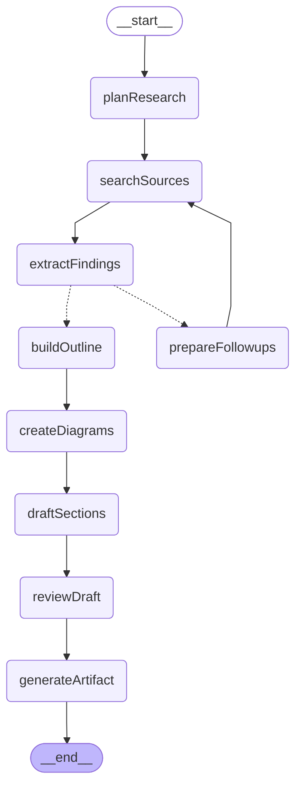

# Deep Research Graph

주제를 여러 라운드에 걸쳐 조사한 뒤, 선택한 장르(논문, 블로그, LinkedIn)에 맞춰 근거와 그림을 갖춘 문서를 작성하는 서브그래프입니다.

## 그래프 구조

## 노드 설명

- **planResearch**: 장르에 맞는 수의 하위 질문과 검색 쿼리로 리서치 브리프(독자, 주장, 언어)를 만듭니다.
- **searchSources**: Tavily `advanced` 검색으로 페이지 원문(markdown)까지 가져오고, URL 기준으로 중복을 제거해 출처를 `S1..Sn`으로 등록합니다.
- **extractFindings**: 하위 질문마다 병렬로 출처를 읽어 근거(주장, 수치, 인용, 출처 id, 신뢰도)와 남은 공백, 후속 쿼리를 뽑습니다. 읽지 않은 출처를 가리키는 근거는 버립니다.
- **prepareFollowups**: 공백이 남아 있고 장르의 라운드 한도가 남았으면 후속 쿼리를 정리해 다음 라운드로 보냅니다(`should_continue_research`).
- **buildOutline**: 장르 가이드에 맞춰 섹션별 목표, 핵심 포인트, 사용할 근거, 분량, 그림 요청을 계획합니다.
- **createDiagrams**: HTML은 구성요소·역할·관계를 구조화해 HTML/CSS 계층도나 SVG 흐름·시퀀스 도식으로 직접 그립니다(`diagrams/native.py`). 전달 데이터와 호출을 표시하고 관계를 임의로 생략하지 않습니다. 전문 표현이 필요한 경우 개요에서 `renderer: "skill"`을 선택할 수 있으며, HTML에서 전문 렌더러가 실패하면 네이티브 도식으로 이어집니다. Markdown은 기존 aws-drawio-diagram / aws-diagram-design PNG 경로를 유지합니다.
- **draftSections**: 섹션 초안을 병렬로 씁니다. 배정된 근거의 `[S#]`만 인용할 수 있습니다.
- **reviewDraft**: 깊이, 논증, 근거, 중복, 장르 적합성을 기준으로 섹션별 수정 지시를 만듭니다.
- **generateArtifact**: 섹션을 순서대로 최종 수정해 캔버스로 스트리밍하고, 인용을 번호 링크로 바꾸고 그림과 참고문헌을 붙여 최종 문서를 반환합니다.

## 장르 프로필 (`genres.py`)

| 장르 | 하위 질문 | 최대 라운드 | 최대 출처 | 분량 | 그림 | 인용 |
|---|---|---|---|---|---|---|
| paper | 6-8 | 3 | 60 | 5,000-8,000 단어 | 최대 3 | 번호 + 참고문헌 |
| blog | 4-6 | 2 | 40 | 2,200-3,800 단어 | 최대 2 | 번호 + 참고 자료 |
| linkedin | 2-3 | 1 | 16 | 짧은 포스트 | 최대 1 | 본문 링크 1-3개 |

LinkedIn은 `~/.claude/skills/linkedin-writer/references/style-guide.md`(또는 `LINKEDIN_STYLE_GUIDE_PATH`)가 있으면 그 문체를 따릅니다.

## 필요 조건

- `TAVILY_API_KEY` (없으면 명시적인 오류로 중단합니다)
- HTML 네이티브 도식에는 다이어그램 스킬, CLI, Chrome, PNG 파일이 필요하지 않습니다. SVG는 정적 요소만 허용하며 하나의 편집 영역으로 다룹니다.
- 전문 PNG 렌더러에는 해당 스킬과 `drawio` CLI(+ `xvfb-run`) 또는 Google Chrome이 필요합니다. HTML에서는 선택 사항입니다.
- PNG 파일은 설정된 research-assets 루트 아래 소유자·실행별로 저장하고, 인증된 `GET /api/research/assets/<runId>/<file>.png`로 제공합니다. 네이티브 도식은 HTML 자체에 포함됩니다.

## 사용 위치

작업실 대화 API는 `researchGenre`를 선택한 요청을 이 그래프로 보내며, `outputFormat`으로 HTML 네이티브 도식을 선택합니다. HTML 어댑터는 Markdown을 파싱한 뒤 신뢰된 도식 위치에 도식·캡션·근거를 넣습니다. 이전 `open_canvas` 그래프의 `deepResearch` 노드에서도 호출하며 이 경로는 Markdown 출력을 유지합니다.
