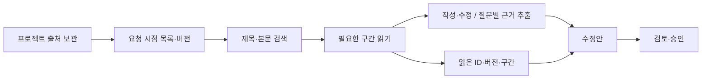

# 필요한 출처만 읽기

프로젝트에 보관한 출처와 AI가 이번 요청에서 읽는 근거를 분리합니다.
예전의 **출처 50개 / 발췌 합계 100,000자**는 더 이상 프로젝트 누적 저장량을
기준으로 일반 대화나 딥리서치를 차단하지 않습니다.

## 사용

- **출처**에서 자료를 계속 추가할 수 있습니다. 제목·주소로 찾고 **발췌 보기**를
  누르면 해당 자료의 본문을 불러옵니다.
- 기존 문서는 **일반 대화**에서 추가·수정을 요청합니다. 에이전트는 필요한
  출처를 검색하고 해당 구간만 읽습니다. 문장 교정에는 출처를 읽지 않을 수도 있습니다.
- 딥리서치는 하위 질문별로 관련 자료를 검색합니다. 후속 질문에는 같은 자료의
  다른 구간을 추가로 읽을 수 있습니다.
- 승인한 문서의 본문 인용은 그대로 유지됩니다. 출처 목록에서 자료를 제거해도
  이미 생성한 수정안이 사용한 근거는 보존됩니다.

## 데이터 흐름

처음 모델에 전달하는 정보에는 출처 개수와 검색·읽기 도구가 포함됩니다.
보관된 발췌문 전체는 넣지 않습니다. 검색 결과도 목록 정보와 읽기 시작 위치이며,
실제 발췌는 `read_source` 또는 기존 `fetch_reference`를 통해 읽었을 때 전달합니다.

검색은 영어 단어와 한국어 단어·부분어를 사용합니다. 일치한 검색 결과의 순서를
유지하고, 자료 안에서도 여러 검색어를 포함한 구간을 선택합니다. 같은 URL의
다른 자료를 합치더라도 관련 없는 발췌를 먼저 읽지 않습니다.

## 요청별 제한

프로젝트의 현재 출처 목록은 **2,000개·32MiB**까지 보관합니다. 이는 모델
컨텍스트와 별개의 저장 한도입니다. 저장 공간이 찼더라도 기존 자료 읽기와
문서 수정은 계속되며, 새 조사 근거는 수정안에 보존하고 목록에 추가하지 못한
사실을 안내합니다.

| 대상 | 제한 |
| --- | --- |
| 출처 하나를 추가할 때 | 발췌 최대 20,000자 |
| 일반 에이전트의 `read_source` 한 번 | 최대 8,000자, 다음 구간 조회 가능 |
| 요청에서 사용하는 근거 | 최대 50개 ID / 발췌 합계 100,000자 |
| 딥리서치의 기존 보관 자료 | 최대 12개 ID / 합계 32,000자 |
| 여러 라운드 리서치의 첫 라운드 | 기존 자료 8개 / 22,000자까지, 후속 조사 공간 확보 |

이는 **해당 요청의 읽기 예산**입니다. 새 요청은 새 예산을 사용하며, 자료를
프로젝트에서 삭제해야 예산이 돌아오는 방식이 아닙니다. 겹치는 구간은 근거
예산에 중복 계산하지 않으며, 반복된 도구 출력은 별도의 전체 컨텍스트 제한을
적용합니다. 저장 파일 크기·입력 형식·실행 시간 등의 운영 제한은 유지합니다.

## 보관과 인용 검증

출처의 변경 불가능한 버전은 기존 공유 파일 저장소의
`.canvas/source-library/blobs/`에 보관합니다. 작업은 해시로 식별한 목록을 사용해
동시에 자료를 수정하거나 제거해도 원래 읽기로 한 버전을 참조합니다.

수정안에는 전체 프로젝트 자료 대신 실제로 읽은 근거와 `sourceReads`
(출처 ID·버전·구간)를 남깁니다. API가 이 기록을 확인하고 검증용 발췌를 재구성합니다.
웹에서 먼저 읽은 근거와 나중에 읽은 프로젝트 자료가 같은 URL이어도 두 근거를
모두 보존합니다. 이름이나 URL만 검색했다고 새 인용을 허용하지 않습니다.

현재 출처, 진행 중인 작업, 보관된 수정안이 참조하는 버전만 유지합니다.
그 어디에서도 사용하지 않는 이전 복사본과 목록 스냅샷은 출처 변경·제거 또는
작업 종료 시 정리합니다. 수정안의 스냅샷에는 그 수정안이 사용한 출처만
포함되므로 관련 없는 자료의 삭제를 막지 않습니다.

이번 호환 릴리스는 이전 API 이미지로 되돌려도 출처가 사라지지 않도록 기존
DynamoDB 인라인 기록도 유지합니다. 서버가 이를 확인하는 것과 모델 컨텍스트에
넣는 것은 별개입니다. 인라인 기록을 제거하는 저장 스키마 변경은 포함하지 않습니다.
새 저장소와 인덱스는 기존 기록을 바탕으로 자동 구성하므로 수동 이관은 필요 없습니다.

## 관련 기록

- [설계](design/on-demand-sources.md)
- [구현 계획과 검토 기록](plans/on-demand-sources.md)
- [검증 결과](verification/on-demand-sources/README.md)
