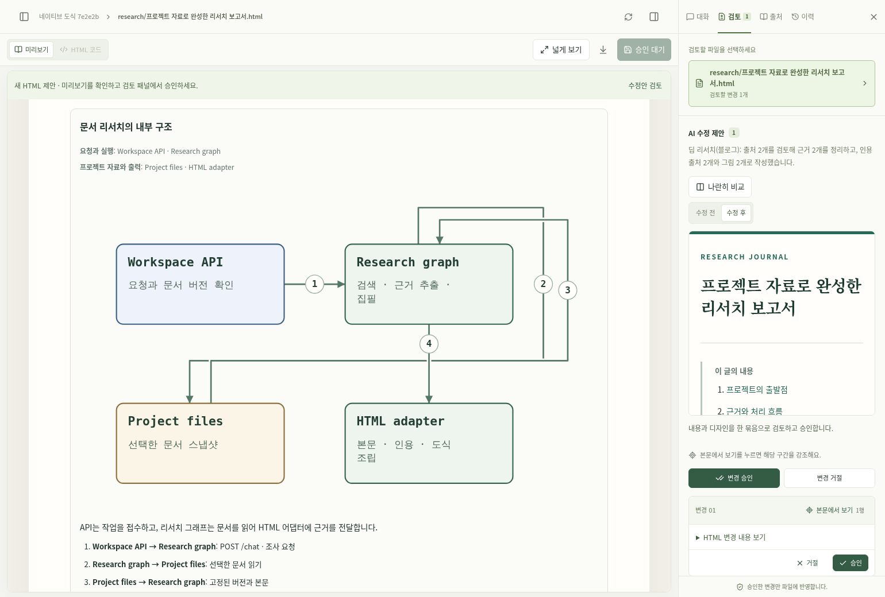

# 딥리서치와 네이티브 HTML 도식

프로젝트 파일과 등록된 출처를 바탕으로 조사한 뒤 Markdown 또는 HTML 문서를
제안합니다. HTML 도식은 HTML/CSS와 SVG로 직접 만들며, 전문 표현이 필요한
경우 설치된 다이어그램 스킬을 선택적으로 사용합니다.

## 사용

1. 작업실에서 참고 문서를 열고 원문·발췌문을 **출처**에 추가합니다.
2. **작성 방식**에서 딥리서치 장르를, **결과 형식**에서 HTML을 선택합니다.
3. 참고할 프로젝트 파일을 최대 다섯 개 선택하고 조사할 주제를 입력합니다.
4. 생성된 HTML의 본문·표·도식·출처를 확인하고 수정안을 승인합니다.
5. SVG는 전체를 한 영역으로 선택해 수정할 수 있습니다. **HTML 다운로드**는
   도식을 포함하므로 앱 밖에서도 열 수 있습니다.

일반 HTML 작성과 딥리서치 HTML 작성 모두 정적 SVG를 지원합니다.
넓은 도식은 글자를 축소하지 않고 가로로 탐색할 수 있으며, **넓게 보기**는
작업실 패널을 접어 HTML 미리보기 공간을 확보합니다.

## 구현 구조

| 단계 | 구현 |
| --- | --- |
| 입력 고정 | 선택한 파일의 버전과 본문을 요청 시점에 보관 |
| 조사 | 기존 LangGraph가 질문 분해, 검색, 근거 추출, 개요, 집필·검토 수행 |
| 도식 명세 | 구성요소의 책임과 관계의 작업·데이터를 구조화 |
| 네이티브 표현 | 계층은 HTML/CSS, 흐름과 시퀀스는 SVG로 렌더링 |
| 선택적 스킬 | 공식 아이콘 등 이점이 있을 때 사용; 실패하면 HTML은 네이티브로 전환 |
| HTML 조립 | 신뢰된 도식 경계와 본문을 분리해 파싱하고 캡션·인용을 결합 |
| 검토·저장 | 공통 수정안 승인 경로를 통해서만 원본 반영 |
| 다운로드 | SVG는 그대로 보관, PNG 사용 시 이미지 데이터를 내장 |

도식의 모든 관계를 표시하고 번호는 연결선 위에 그립니다. 같은 URL의 여러
발췌문 중 질문에 필요한 근거를 읽으며, 보관량과 요청별 읽기 예산은 분리합니다.
[필요한 출처만 읽기](on-demand-sources.md)에서 검색·읽기와 근거 보존 방식을 설명합니다.
SVG는 정적 도형·경로·텍스트만 허용하고 하나의 편집 영역으로 취급합니다.

## 설계와 구현 기록

- [리서치 HTML 설계](design/research-html.md)
- [네이티브 도식 설계](design/native-html-diagrams.md)
- [리서치 HTML 구현 계획·검증](plans/research-html.md)
- [네이티브 도식 구현 계획·검증](plans/native-html-diagrams.md)
- [검증 결과와 예시](verification/research-html/README.md)
- [배포 기록](deployment/2026-10-26-research-html.md)

