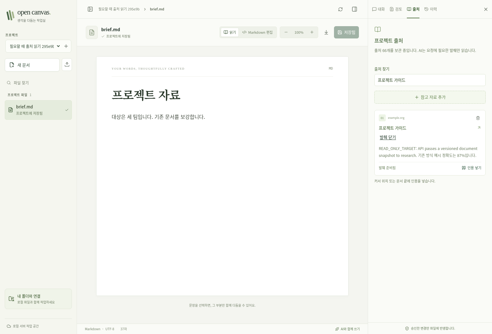
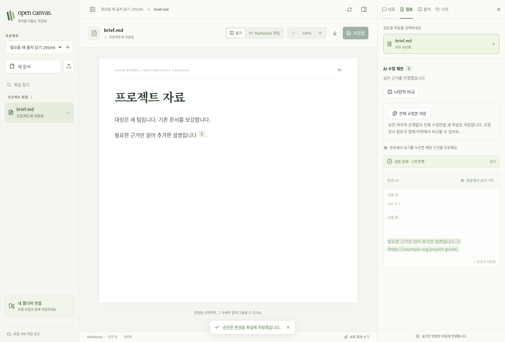
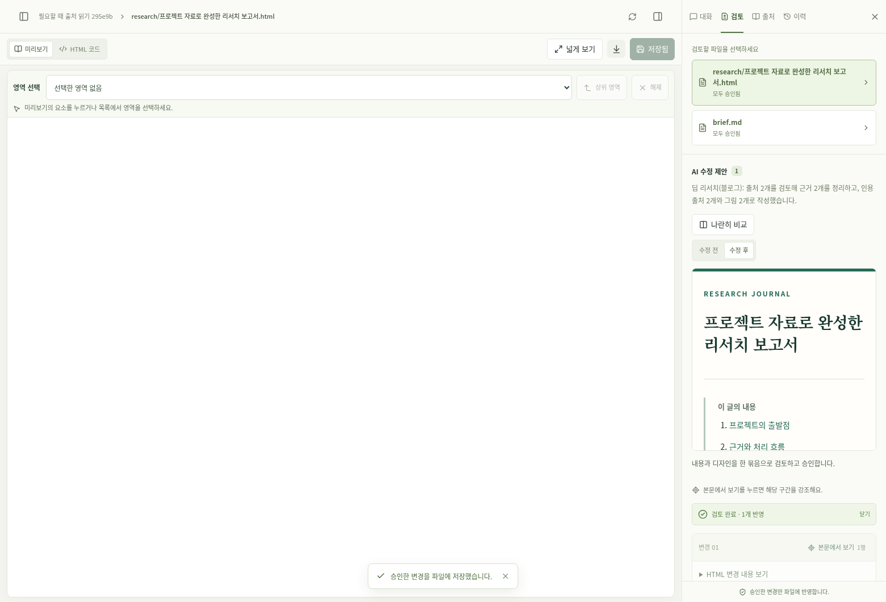

# 출처 필요 시 읽기 검증

## 결과

- 백엔드: 412개 테스트와 101개 하위 테스트 통과. 기존 `datetime.utcnow` 경고 2개 유지.
- 웹: 225개 테스트 통과. 타입 검사와 프로덕션 빌드 통과.
- 린트: 오류 없음. 기존 화면의 경고는 유지.
- 실제 Chromium: 출처 추가 → 필요한 발췌 보기 → 일반 에이전트로 문서 보강 →
  승인 → 추가 딥리서치 → HTML/SVG 승인·다운로드 통과.

브라우저에서는 출처 66개와 총 15만 자 이상의 발췌를 먼저 보관하고, 화면에서
67번째 출처를 추가했다. 일반 에이전트의 초기 입력은 **137자**였으며, 필요한
출처 하나의 **93자**만 읽었다. 새 리서치도 완료되었고 수정안에는 실제 근거
2개만 보관했다. 브라우저 JavaScript 오류는 없었다.

위 수치는 고정 테스트 데이터의 결과다. 모델 응답과 웹 검색 경계는 결정적인
로컬 응답으로 대체했으며, 실제 저장소·에이전트 도구·리서치 그래프·API·브라우저를
연결했다. 유료 모델 호출이나 운영 사용자 데이터 수정으로 얻은 결과는 아니다.

## 독립 검토와 수정

검토에서 발견한 다음 다섯 경우를 실패 테스트로 재현한 뒤 수정했다.

| 경우 | 보장하는 동작 |
| --- | --- |
| DynamoDB 정렬 키 필터 | 제외 처리는 반환 결과에서 수행하고 모든 페이지를 계속 조회 |
| 웹 근거 뒤에 같은 URL의 보관 자료 조회 | 먼저 읽은 웹 근거와 나중에 읽은 보관 자료를 함께 유지 |
| 같은 URL의 여러 발췌 | 실제 검색에 맞은 ID를 먼저 읽고 다른 발췌가 공간을 선점하지 않음 |
| 긴 자료의 후반부에 있는 구체적인 답 | 단순 첫 단어 위치 대신 검색어를 잘 포함하는 구간을 선택 |
| 마지막 질문에 남은 일부 읽기 예산 | 남은 분량에 맞게 읽고 질문을 통째로 건너뛰지 않음 |

마지막 항목은 검토에서 최적화로 분류되었으나, 질문 하나의 근거가 빠질 수 있어
이번 수정에 포함했다. 미해결 검토 항목은 없다.

## 근거 파일

- [백엔드 테스트](backend-tests.txt)
- [웹 테스트](web-tests.txt)
- [독립 검토 회귀 테스트](review-tests.txt)
- [운영 DynamoDB 읽기 검증](dynamodb-query.json), [배포 스크립트 테스트](deploy-tests.txt)
- [타입 검사](typecheck.txt), [린트](lint.txt), [빌드](build.txt)
- [브라우저 결과](browser-results.json)
- [다운로드한 HTML/SVG 보고서](research.html)

## 재현

백엔드에서 `tests/test_source_library.py`, `test_source_jobs.py`,
`test_source_research.py`, `test_source_regressions.py` 및 기존 전체 테스트를
실행한다. 웹 테스트에는 `SourcesPanel.test.tsx`가 포함된다.

브라우저 테스트는 `apps/web/tests/on_demand_sources_backend.py`를 명시적인
로컬 인증·임시 저장소로 실행한 뒤, 해당 API를 바라보는 웹 서버에서
`apps/web/tests/on_demand_sources_smoke.py`를 실행한다. 결과는 이 디렉터리에 남는다.
